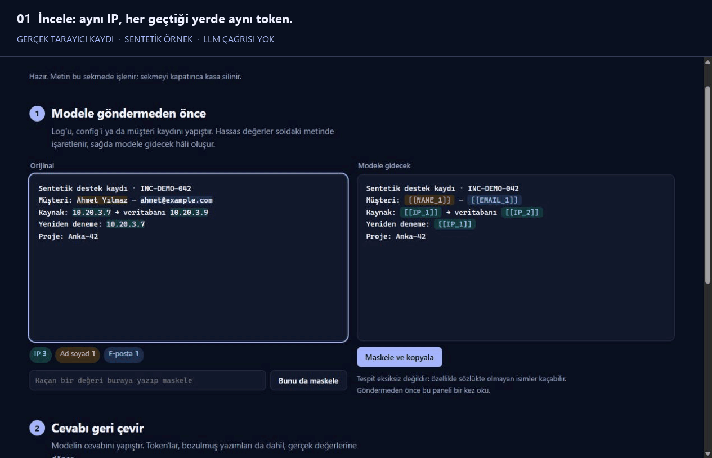

<p align="center">
  <picture>
    <source media="(prefers-color-scheme: dark)" srcset="assets/brand/logo-dark.png">
    
  </picture>
</p>
<p align="center">
  <a href="https://github.com/temurcanbulut/maskele/actions/workflows/ci.yml"></a>
  
  
  <a href="LICENSE"></a>
</p>

<h1 align="center">Share the problem, not the data.</h1>
<p align="center">Replace sensitive values before sharing text with an LLM.<br>Keep consistent tokens. Restore the answer locally.</p>
<p align="center"><a href="README.tr.md">Türkçe</a> · <a href="https://temurcanbulut.github.io/maskele/">Try in your browser</a> · <a href="#run-locally">Run locally</a> · <a href="docs/ARCHITECTURE.md">How it works</a></p>



Recorded from the running application with synthetic data. The reply is a typed example; no LLM is contacted. [Walkthrough and recording context](docs/DEMO.md).

## A small step before you share

Logs and support tickets often contain more than the problem: a customer name, an internal IP, an email address, a credential. Maskele replaces detected values on your machine, then uses the same local mapping to restore tokens in a reply.

```text
Customer: Ahmet Yılmaz            Customer: [[NAME_1]]
Contact: ahmet@example.com        Contact: [[EMAIL_1]]
Database: 10.20.3.7               Database: [[IP_1]]
Retry on 10.20.3.7                Retry on [[IP_1]]
```

Repeated values keep their tokens within a session. The surrounding context and relationships remain visible. **Detection is incomplete:** names and unstructured identifiers can be missed. Review the masked text before sharing it.

## Choose your workflow

| Interface | Use it for | Mapping lifetime |
|---|---|---|
| [Browser](https://temurcanbulut.github.io/maskele/) | Try the Python engine through WebAssembly; no install | This tab's memory |
| `maskele ui` | Review, manually mask and restore text on localhost | Process memory by default |
| `maskele mask` / `unmask` | Files, pipes and repeatable terminal work | Local session vault; encryption is optional |
| `maskele proxy` | Supported OpenAI-compatible and Anthropic JSON requests | Per-request memory; linked Responses conversations retain scoped mappings for up to one hour |

The browser downloads its own assets and Pyodide from the same site. Text processing happens in the tab. The proxy intentionally contacts the configured upstream; detected values are replaced, while authentication headers and other permitted fields are forwarded. [Trust boundaries](SECURITY.md).

## See it in context

These illustrated scenarios use invented records. Masking and restoration use the Maskele engine; model replies are written examples. The illustrations are in Turkish.

### Keep repeated values connected

Within the same local session, repeated IP addresses retain their tokens. Known name aliases can also refer back to the same person, so a masked record keeps useful relationships.


### Troubleshoot logs with detected secrets masked

The database password, JWT and IP addresses become tokens while the error message and port stay readable. Tokens in the example reply are restored using the same local mapping.


[Explore all four scenarios: network access, consistent tokens, customer support and DevOps](docs/USE_CASES.tr.md).

## Run locally

Python 3.11+. In a terminal:

```sh
git clone https://github.com/temurcanbulut/maskele.git
cd maskele
python -m venv .venv
```

Activate `.venv\Scripts\Activate.ps1` in PowerShell, or `source .venv/bin/activate` on Linux/macOS, then:

```sh
python -m pip install ".[crypto]"
maskele ui
```

Open `http://127.0.0.1:8788`. Paste text, inspect the preview, add any missed values, then choose **Maskele ve kopyala**. Paste a reply below to restore tokens from the same session. The core also installs without `[crypto]`; that extra enables encrypted disk vaults.

```sh
maskele mask examples/ornek.log > masked.log
maskele unmask reply.txt
maskele scan src/ --format json --output report.json
maskele proxy --provider openai
```

For a proxy client, set its base URL to `http://127.0.0.1:8787/v1` and supply your provider credentials as usual. Requests can reach the provider. [SDK examples](examples/) · [Full CLI and configuration reference (Türkçe)](docs/USAGE.tr.md).

## Detection, measured with its limits

Built-in detectors cover email, IPv4/IPv6, phone numbers, Turkish identity/tax numbers, IBANs, cards, plates, names, addresses and common secret formats. Checksums validate formats; they do not prove whether a value belongs to someone. Manual values, extra names and project rules extend detection.

The bundled synthetic benchmark contains **3,000 samples and 4,556 labeled values**, seed `20261015`. On the current engine, **2.50%** of labeled values have at least one non-whitespace character left exposed. There are **0 false-positive lines out of 38 negative examples**. These are regression measurements on a small, constructed corpus, not real-world privacy guarantees.

| Name group | Values with exposed characters |
|---|---:|
| In the name dictionary | 0.7% |
| Outside the dictionary | 12.2% |
| Lowercase names | 35.7% |
| Foreign names | 51.2% |

[Full results and methodology](docs/benchmark.md) · [Machine-readable run](docs/verification/benchmark.json).

## Boundaries to understand

- Missed values and unmasked context can still identify people. This is pseudonymization, not guaranteed anonymization.
- Images, audio and file references are not inspected. Proxy users can set `[proxy] media = "block"` to reject them.
- Local vaults contain original values. Use encryption for sensitive disk sessions; a running process still needs access to the plaintext.
- Provider behavior, real API integrations and privacy compliance require separate validation. Protocol tests use local mock upstreams.
- The bundled HTTP servers are intended for local use. Public deployment needs authentication, TLS and an appropriate gateway.

## Development

```sh
python -m pip install -e ".[dev]"
python -m pytest -q
python -m ruff check .
python -m ruff format --check .
python benchmarks/run.py
```

CI runs on Linux, macOS and Windows with Python 3.11–3.13. The browser build has a separate real-Pyodide smoke test before Pages deployment. [Verification record](docs/VERIFICATION.md) · [Contributing](CONTRIBUTING.md) · [Changelog](CHANGELOG.md) · [Security](SECURITY.md).

MIT © Temur Can Bulut.
