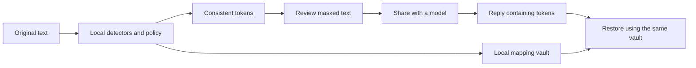

# How Maskele handles text

Detection uses patterns, checksums and name/context rules. It is not an LLM and requires no model download. A value can match a format without belonging to a real person. A missed value is left in the text.

`Masker` owns the detection policy and mapping vault. Repeated normalized values receive consistent tokens. Restoration recognizes only tokens from that vault; unknown tokens remain visible in the result. The default CLI/UI restoration accepts bracketed variants; the proxy uses strict token restoration to avoid replacing code variables.

## Interfaces and data lifetime

- **CLI:** a session vault on disk lets `mask` and `unmask` run as separate commands. Encryption uses scrypt and AES-256-GCM through the optional `cryptography` package.
- **Local UI:** `UIServer` binds to localhost, validates Host and requires a per-process token for API calls. `UIApp` provides the HTTP-independent application behavior. The default UI vault is in memory.
- **Browser:** the same `UIApp` and engine run in Pyodide. Page assets and the runtime are served from the same site. Text stays in the browser; the site's code and the browser remain part of the trust boundary.
- **Proxy:** supported JSON requests are masked before forwarding; responses are restored with the request's mapping. Linked Responses conversations retain credential-scoped mappings in memory with a one-hour expiry. Authentication headers are intentionally forwarded. Unscanned media is permitted by default and labeled; `media = "block"` rejects it.

The proxy is not an isolation boundary against software controlling this machine, and the bundled HTTP servers are not public application servers. [Security model](../SECURITY.md) · [Detailed configuration](USAGE.tr.md).

## Source map

| Path | Responsibility |
|---|---|
| `maskele/detectors.py`, `names.py` | Pattern, checksum, name and context rules |
| `maskele/core.py` | Masking, consistent tokens and streaming restoration |
| `maskele/vault.py` | Session mappings, encryption and atomic persistence |
| `maskele/config.py` | Configuration and project trust policy |
| `maskele/proxy.py` | Provider protocols, request policy and response handling |
| `maskele/uiapp.py`, `ui.py`, `web/` | Shared application logic, localhost server and interface |
| `benchmarks/run.py` | Seeded synthetic detection regression corpus |
| `scripts/build_site.py`, `site-src/` | Same-origin Pyodide browser build |

## File permissions

POSIX vault files use mode `0600` and their directory uses `0700`. Windows access is governed by NTFS ACLs; POSIX mode bits do not establish equivalent access control. Use a private profile directory and encrypted vaults for sensitive Windows CLI sessions. The test suite checks POSIX modes on POSIX systems and tests encryption/restoration on all platforms.
