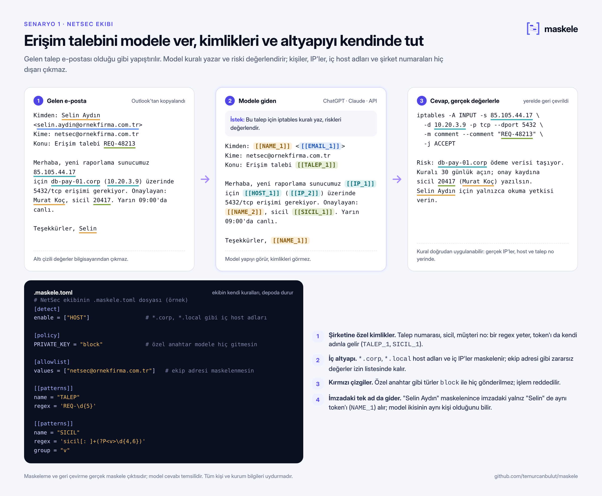
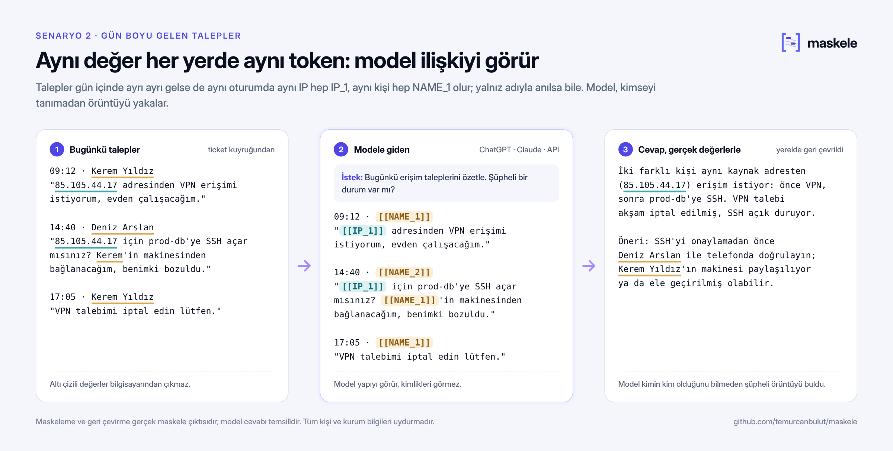
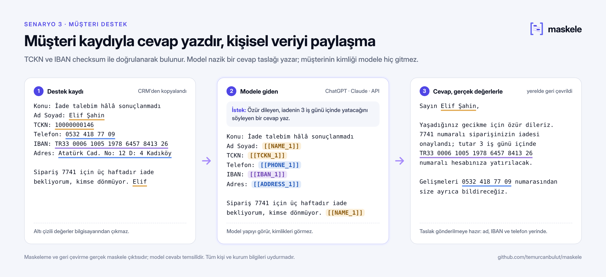
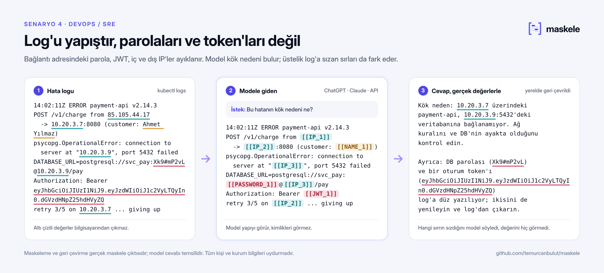

# Kullanım senaryoları

[← Ana sayfa](../README.tr.md)

## Nerede işe yarar

Aşağıdaki görsellerde maskeleme ve geri çevirme gerçek maskele çıktısıdır
(`scripts/scenes.py` her seferinde motoru çalıştırarak üretir); yalnızca model cevabı temsilîdir.

**NetSec: erişim talebi.** Gelen e-posta olduğu gibi yapıştırılır, model iptables kuralını yazar.
Talep numarası, sicil ve iç host adları ekibin kendi `.maskele.toml` kurallarıyla maskelenir
([örnek dosya](senaryolar/netsec.maskele.toml)).

**Gün boyu gelen talepler.** Aynı IP her talepte `IP_1`, aynı kişi her yerde `NAME_1`; yalnız
adıyla anıldığında bile. Model kimseyi tanımadan şüpheli örüntüyü görür.

<b>Müşteri destek ve DevOps senaryoları</b>

